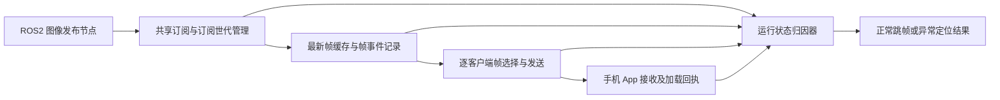
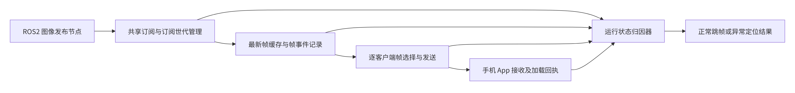
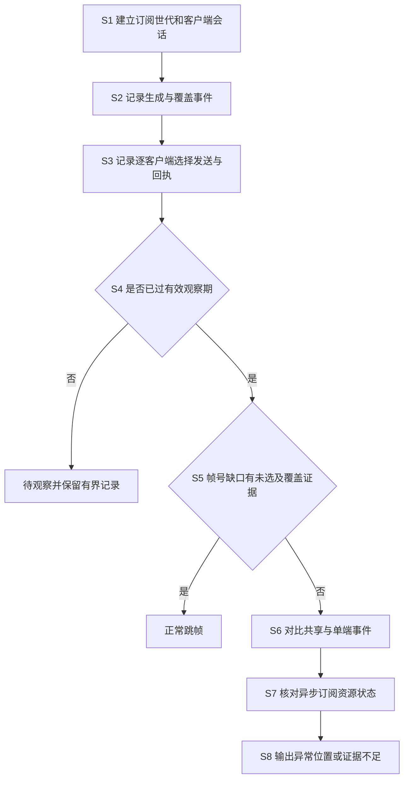
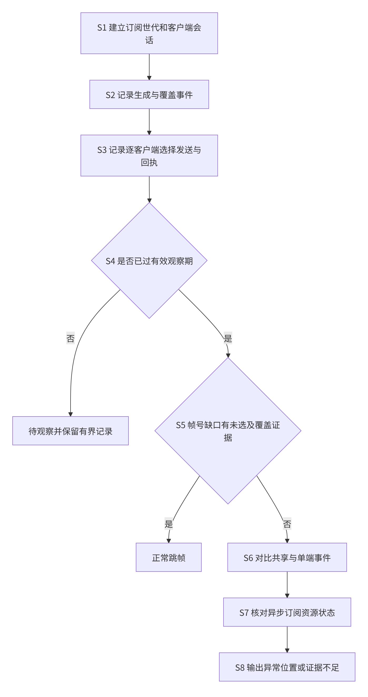

# 发明专利技术交底书（初稿）

**专利类型：** 发明（按用户未指定类型时的默认类型起草）  
**发明人、申请人、技术联系人：** 待填写  
**技术方案成熟度：** 现有网关已实现图像话题按需订阅、共享通道、最新帧缓存、逐帧编号及手机端接收／加载回执；本稿的订阅世代、逐客户端帧选择记录及自动归因规则属于拟实施、待实验验证的方案。

## 1. 本发明的名称和应用的产品

### 1.1 本发明的名称

一种 ROS2 图像网关共享订阅的运行状态监测与帧缺失归因方法。

### 1.2 应用的产品

应用于装有 ROS2 图像采集或图像处理节点的机器人、移动设备及其边缘计算装置。例如，机器人上的计算设备运行图像话题发布节点与图像网关，多个手机 App 在测试和调试过程中分别查看 ROS2 图像。图像网关可以将 `sensor_msgs/msg/Image` 或 `sensor_msgs/msg/CompressedImage` 转换或转发为供 App 显示的图像帧。

### 1.3 预审领域与分类号预判

本稿以**网关计算程序的运行监测、共享订阅资源状态核对和软件处理事件归因**为技术中心，拟从 G06F（电数字数据处理）中的运行监测方向判断主分类，优先核对 G06F 11/30，并视具体权利要求核对 G06F 11/34。广州知识产权保护中心[2026 年专利预审服务分类号表](https://scjgj.gz.gov.cn/gkmlpt/content/10/10629/post_10629477.html)收录 G06F 主分类小类；[IPC 2026.01 分类表](https://www.cnipa.gov.cn/art/2025/12/31/art_3161_203422.html)供进一步细分。最终主分类应依据实际完成的技术方案确定，不能仅由本段预先指定。

## 2. 详细介绍技术背景，并描述已有的与本发明最相近似的实现方案

### 2.1 技术背景

在机器人图像链路测试中，ROS2 图像节点持续发布图像话题，边缘计算设备上的网关为手机 App 建立订阅，读取图像并通过 WebSocket 发送。为限制资源消耗，网关可对同一话题和消息类型复用一个订阅，缓存最新一帧，并按每个客户端的发送节拍向其传输。客户端显示帧率低于话题发布帧率时，相邻已显示帧的编号可能不连续；这是实时预览系统允许的结果，并不能直接认定为传输故障。

另一方面，图像停止更新也可能来自发布者停止、网关订阅尚未建立、图像转换失败、某个客户端发送受阻，或 App 已接收但尚未完成加载。若客户端恰在异步订阅创建过程中断开，仅观察某一时刻的引用数量或订阅对象状态，还可能把正常的回收过渡过程误认为资源泄漏。因此，单看 App 帧率、相邻帧号或端到端时延，难以对共享订阅的运行状态作出可重复的判断。

### 2.2 最相近的已公开方案

检索说明：本轮查看了公开专利文本，以“视频链路故障溯源”“ROS2 话题诊断”“图像帧分段时延”“图像处理链路异常检测”“假丢帧”等概念交叉核对。下表为本轮最相关的公开文献；这是起草前的初步检索范围，不表示已经穷尽现有技术。

| 公开文献 | 已公开的主要方案 | 与本稿的关系 |
| --- | --- | --- |
| [CN121547576A，面向视频监控系统的业务路径追踪与故障溯源方法及装置](https://patents.google.com/patent/CN121547576A/zh) | 利用追踪标识关联视频路径节点，分解时延、建立健康基线并定位根因 | 是本稿最接近的出发点；“分段打点加基线定位”不能作为本稿唯一创新点 |
| [CN121050973A，基于 ROS 2 系统的通信话题监测及诊断方法与系统](https://patents.google.com/patent/CN121050973A/en) | 建立话题监测线程和订阅者，统计消息并按规则诊断 | 表明“订阅 ROS2 话题、计算频率并报警”已有公开 |
| [CN120567348A，一种远控驾驶系统的时延测试方法及系统](https://patents.google.com/patent/CN120567348A/zh) | 获取图像帧多阶段时间戳并计算阶段时延 | 表明逐帧分段测速不是独立区别 |
| [CN116402740A，异常链路检测方法、装置、电子设备以及存储介质](https://patents.google.com/patent/CN116402740A/zh) | 根据图像处理全链路的检测信息确定异常环节 | 表明宽泛的图像链路异常定位已有公开 |
| [CN116436932B，一种数据处理方法、装置、设备及存储介质](https://patents.google.com/patent/CN116436932B/zh) | 区分数据延迟造成的假丢帧与真实缺帧 | 表明“区分真假丢帧”亦不能脱离具体机制独立主张 |

选 CN121547576A 作为主要对比文献，是因为它与本稿均针对视频业务运行异常进行跨环节关联与归因；其权利要求已覆盖追踪标识、时延分解、动态基线和根因定位的组合。本稿拟议的区别集中于**动态共享订阅这一计算机运行对象，以及逐客户端帧选择与订阅资源事件的共同判定**。目前这一判断仅基于已读公开文本，仍需复核更广的专利和非专利文献。

## 3. 现有技术／产品与本发明的对比，以及本发明的目的

### 3.1 现有技术／产品与本发明的对比

现有项目中的图像网关可以根据客户端请求创建或复用 ROS2 图像订阅，同一话题仅缓存最新帧；客户端收到帧后可以回报“已接收”及“已加载”。这些功能构成实施本稿的基础，但现有实现没有把订阅重建划分为可比较的世代，没有逐客户端保存发送节拍上的帧选择原因，也没有完成自动帧缺失归因。本稿不把这些拟新增能力叙述为已经实现。

与 CN121547576A 相比，拟议方案将一个可动态创建和销毁的 ROS2 订阅作为被监测对象。在订阅的每个有效世代内，将网关生成的帧、某个客户端实际选中的帧、网关已写出的帧、App 已接收及已加载的帧区分记录；再结合订阅创建与释放的异步完成事件，对帧号缺口和资源状态分别判定。其主要区别如下。

| 编号 | 对比点 | 主要对比文献的做法 | 本稿拟实施的做法 |
| --- | --- | --- | --- |
| F1 | 帧身份的适用范围 | 用视频业务追踪标识关联路径信息 | 按“话题及消息类型—订阅世代—客户端会话—世代内帧号”标记处理事件；订阅重建后另起世代，避免将重置的帧号误认为丢帧 |
| F2 | 帧号缺口的判别依据 | 主要对比阶段时延、性能指标与基线 | 每个客户端发送节拍记录可用帧、实际选帧及未选原因；把最新帧覆盖或发送频率上限造成的正常跳号与“已选帧缺少相应处理事件”分开统计 |
| F3 | 多客户端的异常归因 | 在视频业务路径中寻找异常节点 | 同一共享订阅世代下比较多个客户端的共有处理事件与各自回执；共同异常与单端异常走不同的定位分支 |
| F4 | 异步资源状态的异常判断 | 未针对 ROS2 动态订阅的创建、共享与回收过程设定规则 | 结合订阅状态、已完成的获取／释放事件及实际持有会话数核对资源；对创建中断线的情形等异步结果收敛后再判断 |

F1 至 F4 共同服务于一个目的：在共享订阅和最新帧缓存同时存在时，为网关程序的运行状态提供可信的诊断依据。单独的时间戳、频率统计、常规阈值或 App 展示界面均不作为本稿拟保护的中心。

### 3.2 本发明的目的

本发明拟解决三个具体技术问题：第一，实时图像预览中相邻帧号跳跃时，如何避免将正常丢弃旧帧误判成程序故障；第二，多客户端共享一个 ROS2 图像订阅时，如何区分共享处理阶段与单个客户端的异常；第三，客户端在异步订阅创建或释放期间断开时，如何准确判断订阅资源最终是否得到回收。

预期技术效果应以测试结果证明，包括正常跳帧场景的误报率、指定故障注入场景的定位准确率，以及断线竞争场景中订阅对象的实际回收情况；本稿不预填尚未实测的改善百分比。

## 4. 本发明技术方案的详细阐述，必要时结合示意图进行说明

### 4.1 系统框架图

<!--  -->

共享订阅与订阅世代管理模块运行在网关计算设备上，负责在 ROS2 执行器线程内创建或销毁订阅。帧事件记录模块以轻量级、容量有界的记录保存处理事件。逐客户端模块按照各自发送节拍选择最新帧，并记录该选择行为；归因器读取上述运行事件，按规则输出结果。App 图像展示不构成本稿的必要创新步骤，其回执用于还原处理过程。

### 4.2 详细说明

**S1，创建订阅世代。** 对话题名称和消息类型组成的键，当首个客户端获取图像通道且订阅创建成功时，生成本次订阅世代标识。多个客户端共用同一订阅时保持该世代；该订阅实际销毁并再次创建时启用新的世代。对正在创建、活动、正在释放、已关闭等状态分别记录状态转换事件。客户端在创建尚未完成时断开，先保留待收敛状态，等待创建任务返回后执行对应释放。

**S2，登记世代内图像处理事件。** 网关收到 ROS2 图像消息后，记录回调到达事件，并根据消息类型进行透传或必要的转换、编码；转换成功后分配世代内递增帧号，将图像置入最新帧缓存。若新帧覆盖旧缓存，记录被覆盖帧号及覆盖时刻；若转换失败，记录失败发生的处理阶段。记录容量应有限，超过窗口的历史可以按时间淘汰。订阅采用的 QoS 及其与发布者的实际兼容性须以部署测试为准。

**S3，记录每个客户端的选择与回执。** 为每个有效客户端会话记录其所属世代及发送节拍。在每次节拍到来时，读取当前可用最新帧号、该客户端上次选中帧号和本次实际选中帧号；如果两次选中之间出现未发送帧，结合最新帧覆盖记录及当时的节拍状态记录“未被该客户端选中”的原因。已选中的帧在写出元信息和图像数据后，记录发送完成事件；手机分别在收到该帧及完成图像加载后返回对应回执。回执须同时匹配世代、客户端会话和帧号，过期或跨世代回执不参与当前诊断。

**S4，形成可判定的帧处理状态。** 对每个客户端会话，在一个有界观察窗口内分别形成以下事件集合：网关成功生成的帧、该客户端节拍选中的帧、网关写出的帧、App 回报已接收的帧、App 回报已加载的帧。判断时只在相应事件已到达有效截止时刻后，将“已选中但后继事件缺失”的帧列为异常候选。未被选择且有覆盖证据的帧归入正常跳帧；回执尚在有效期内的帧归入待观察；连接已关闭或订阅世代已经结束的帧不与新世代数据混算。

**S5，进行跨客户端与订阅资源归因。** 如果一个订阅世代内所有活动客户端均缺少新生成帧，先核对发布者状态、订阅是否活动及网关回调是否收到数据，输出“共享输入阶段异常”或“证据不足”，不把该现象直接归咎于网络。若共享帧持续生成，但仅一个客户端缺少发送完成或回执事件，则将问题限定在该客户端对应的发送或加载阶段。若多个客户端在共享转换阶段出现相同错误，则定位到共享图像处理阶段。对于资源状态，只有在获取、释放等异步任务完成后，才核对有效持有客户端数量与网关订阅对象状态是否一致；超出预设收敛时限仍不一致时，输出订阅资源异常。

**S6，输出可复核的诊断记录。** 每条记录包含话题及消息类型、订阅世代、客户端会话、相关帧号区间、作为判定依据的事件及缺失事件、最终类别和证据是否充分。类别至少包括正常跳帧、待观察、共享输入异常、共享处理异常、单客户端发送或加载异常、订阅资源异常、证据不足。网关与手机单向时延仅作辅助信息：当校时样本质量不足时不据其作故障定性。

### 4.3 判定流程图

<!--  -->

### 4.4 关键参数与实施边界

观察窗口、发送节拍、回执有效期和资源收敛时限应由网关实际帧率、客户端显示频率及测试设备负载确定，不能因单个迟到回执就判断丢帧。窗口缩短可更快发现异常，但会增加迟到回执导致的误报；窗口延长则相反。帧事件记录和回执缓存须有容量上限，防止监测本身给边缘计算设备带来无界内存占用。跨端时钟若需估算单向时延，应单独给出时钟误差边界；本方法的核心分类优先使用同一端的事件顺序、帧号及回执匹配，避免依赖不可靠的跨端绝对时间。

### 4.5 实施场景与拟验证方法

**场景一：正常的最新帧覆盖。** 在合成图像话题发布频率高于某一客户端发送上限时，比较该客户端两次选中帧间的未选帧与覆盖事件。预期输出为正常跳帧；这一场景用来验证不会把计划内帧替换误报为通信故障。

**场景二：共享订阅与单端异常区分。** 使两个客户端订阅同一话题，分别注入共享图像转换故障和单个客户端加载停滞。检查系统能否借助相同世代内的共享帧事件与不同客户端回执，将两类故障区分开。

**场景三：异步创建中断线。** 使客户端在订阅创建尚未完成时断开，随后等待创建结果及释放结果，检查订阅对象最终销毁且诊断过程未将短暂待收敛状态标为泄漏。

上述均为**拟进行的验证**，本稿尚无实测数据。正式申请前，应记录测试设备、ROS2 版本、话题类型、发布及发送频率、故障注入方式，并与“仅按帧号缺口报警”“仅按总时延阈值报警”的方案比较误报率、定位准确率及资源回收结果。

### 4.6 技术关键点和拟保护内容

本稿拟作为一个整体保护：**订阅世代划分、逐客户端帧选择事件记录、结合共享与单端事件的缺失归因，以及异步订阅回收状态核对**。若删除世代信息，订阅重建前后的帧号难以安全比较；若删除逐客户端选择事件，正常覆盖可能被误报；若删除共享与单端对照，难以区分共有处理故障与单端故障；若删除异步完成状态，资源异常判断可能失真。

可作为优选实施方式而非必要条件的内容包括：特定 WebSocket 文本／二进制帧封装方式、手机界面展示样式、某一固定发送帧率、某一固定观察窗口长度，以及图像具体采用 JPEG 或其他兼容编码。实际撰写权利要求时，应围绕上述技术关键点及实验支持的判定规则确定保护范围。
